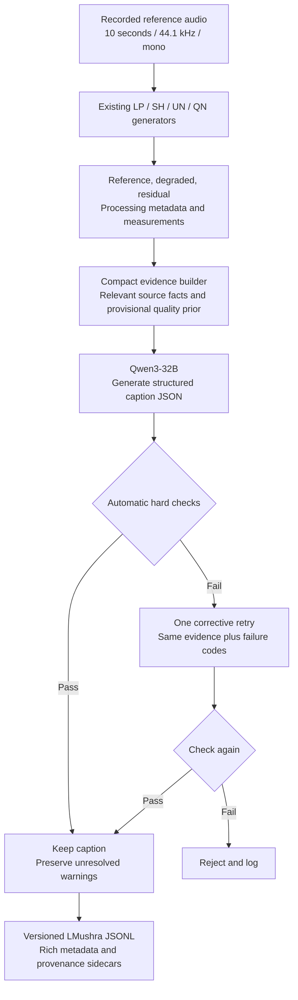

# DeepMUSHRA caption generation: process, prompt, and validation

For dataset locations, calibration listeners, training usage, and small POC sets, see the [Dataset handoff guide](dataset_handoff_guide.md).

**Report date:** 2026-11-23. **Scope:** the completed `caption-poc-fast-v3` million-input run, not a new experiment or a claim about later pipeline revisions.

**Result:** 1,000,000 original examples processed; **999,773 calibrated captions exported** and **227 rejected**. Captions are **metadata-grounded, LLM-generated pseudo-labels**, not human-verified perceptual annotations.

## 1. Pipeline at a glance



The caption stage reads finalized published checkpoints. It does not regenerate audio, refit calibration, or change sample IDs or source-grouped splits. The teacher reads **metadata only**, not audio.

| Artifact | Synthetic processing family |
|---|---|
| LP | Attenuate high-frequency content through low-pass filtering |
| SH | Remove or attenuate selected time-frequency regions |
| UN | Replace selected tonal structure with noise-like components |
| QN | Add signal-shaped noise while retaining the original signal |

PE and TM remain held out. Provisional quality estimates come from frozen ODAQ-informed calibration; operator equivalence and transfer to synthetic mono examples remain unvalidated. QN uses the empirical mono-SNR proxy bridge, not numeric NMR = SNR substitution.

## 2. Evidence and annotation strategies

Teacher evidence contains relevant processing parameters, objective measurements, processing-region summaries, reliable source/content facts, and uncertainty. Processing regions are **not** annotations of audible events. Residual energy can include phase differences and is **not** automatically removed energy or perceived severity.

No candidate perceptual attributes, perceptual whitelists, old captions, example answers, or score-to-adjective tables are supplied.

| Strategy | Teacher input | Completed coverage |
|---|---|---|
| `technical_template` | No teacher; deterministic technical baseline | 1,000,000 examples |
| `metadata_llm` | Processing/source facts and measurements; no quality scores, grades, or intervals | 1,025 usable sampled examples |
| `calibrated_llm` | Same evidence plus provisional quality estimate, available uncertainty, and transfer limitations | 999,773 usable examples; primary export |

The three-strategy matched comparison contains 1,025 examples. The primary calibrated export is not restricted to this intersection.

## 3. Prompt and teacher settings

The task is to describe **changed acoustic character** and, when supported, **tentative overall quality impact**. A different quality prior must not change the acoustic facts. Input numbers are reasoning evidence; they must not be transcribed into the caption.

**Teacher:** `Qwen/Qwen3-32B`, revision `9216db5781bf21249d130ec9da846c4624c16137`; non-thinking generation, temperature **0.6**, top-p **0.95**, maximum **384 output tokens**, base seed **20261113** with deterministic sample/strategy/attempt-derived seeds. Seven serving replicas used the same teacher model, not a multi-teacher ensemble.

The JSON contract was requested with an assistant JSON prefill and checked after generation. Do not interpret the schema/version names as proof that the serving engine grammar-enforced every response.

### Complete system prompt

```text
Use the processing facts and objective measurements to infer the character of the difference between processed and reference audio. Use an available provisional quality estimate for a tentative overall quality impact, preserving uncertainty about transfer to this sample. A quality estimate must not change the supplied acoustic facts.
Input numbers and technical parameters are evidence for reasoning, not material to transcribe. Write one or two concise, natural comparative sentences about the perceptual difference, not the processing procedure or annotation method. Choose your own vocabulary; no perceptual term or artifact-specific phrase is required.
Do not add claims beyond the evidence. A measurement supports its own quantity, not an unmeasured outcome. Omit unsupported effects or extent. You have no audio access: do not invent source content, events, times, human judgments or definite audibility. Keep uncertainty in the wording without requiring a particular hedge. Do not mention numerical quantities, parameter settings or dataset names in the description.
Return exactly these JSON fields:
description: the comparison text.
grounded_attributes: short, open-vocabulary phrases reflecting only the description.
severity_used: true when the description explicitly grades acoustic extent or expresses overall quality impact; false for an ungraded directional change. This is a text declaration, not proof of prior use.
quality_impact_omission_reason: null if the description expresses tentative overall quality impact; otherwise the specific reason for omitting that assessment. This field concerns overall impact, not every unstated acoustic detail. Acoustic extent alone may use severity_used=true with a non-null reason.
confidence: high, medium, low or unverified for metadata support, not human agreement.
```

### Calibrated user prompt

```text
Compare using the evidence below. When supplied, the provisional quality prior uses a 0-100 scale, with higher values closer to reference quality. Use it for a tentative overall impact; uncertainty about transfer qualifies that assessment rather than automatically forbidding it. If absent or otherwise unusable, omit the overall assessment and give the specific reason. Do not equate overall quality with the magnitude of one acoustic change.

Evidence JSON:
{"evidence": <sample-specific processing facts, measurements, source context, uncertainty, and quality prior>}
```

### Metadata-only user prompt

```text
Compare using the evidence below. This strategy supplies no quality prior. Describe supported character and acoustic extent; omit a prior-informed overall quality assessment and state why it is omitted.

Evidence JSON:
{"evidence": <sample-specific evidence without quality-prior information>}
```

### Corrective retry

Retries contain the same evidence and explicit failure codes, not the previous caption or an expected answer. The actual retry instruction is:

```text
Compose a fresh complete response addressing only the listed failures. Keep the same evidence and open vocabulary; do not remove numbers from an otherwise unchanged sentence or invent differences. Align the flags and omission reason with what the description actually states.
```

<details>
<summary>Complete rendered production prompt with real LP evidence</summary>

This is the preserved real production example, including chat delimiters and the assistant prefill. Its input quality interval is conditional reference-domain uncertainty, not a confidence interval for this synthetic mono audio.

```text
<|im_start|>system
Use the processing facts and objective measurements to infer the character of the difference between processed and reference audio. Use an available provisional quality estimate for a tentative overall quality impact, preserving uncertainty about transfer to this sample. A quality estimate must not change the supplied acoustic facts.
Input numbers and technical parameters are evidence for reasoning, not material to transcribe. Write one or two concise, natural comparative sentences about the perceptual difference, not the processing procedure or annotation method. Choose your own vocabulary; no perceptual term or artifact-specific phrase is required.
Do not add claims beyond the evidence. A measurement supports its own quantity, not an unmeasured outcome. Omit unsupported effects or extent. You have no audio access: do not invent source content, events, times, human judgments or definite audibility. Keep uncertainty in the wording without requiring a particular hedge. Do not mention numerical quantities, parameter settings or dataset names in the description.
Return exactly these JSON fields:
description: the comparison text.
grounded_attributes: short, open-vocabulary phrases reflecting only the description.
severity_used: true when the description explicitly grades acoustic extent or expresses overall quality impact; false for an ungraded directional change. This is a text declaration, not proof of prior use.
quality_impact_omission_reason: null if the description expresses tentative overall quality impact; otherwise the specific reason for omitting that assessment. This field concerns overall impact, not every unstated acoustic detail. Acoustic extent alone may use severity_used=true with a non-null reason.
confidence: high, medium, low or unverified for metadata support, not human agreement.<|im_end|>
<|im_start|>user
Compare using the evidence below. When supplied, the provisional quality prior uses a 0-100 scale, with higher values closer to reference quality. Use it for a tentative overall impact; uncertainty about transfer qualifies that assessment rather than automatically forbidding it. If absent or otherwise unusable, omit the overall assessment and give the specific reason. Do not equate overall quality with the magnitude of one acoustic change.

Evidence JSON:
{"evidence":{"artifact":"LP","source_context":{"sample_rate_hz":44100,"channels":1,"duration_s":10.0,"content":{"type":"speech"},"content_evidence":"supplied source metadata; not audio inference","perceptual_cleanliness":"unverified"},"processing":{"operation":"A causal low-pass filter is applied. Its frequency-dependent phase/group delay is not compensated.","parameters":{"cutoff_hz":7661.714968025335,"transition_hz":1500,"passband_ripple_db":0.5,"attenuation_db":60,"filter_design":"butterworth"}},"signal_measurements":{"values":{"relative_residual_energy":1.32410143082727,"normalized_spectral_magnitude_error":0.060845099293548664,"affected_tf_ratio":0.6497560975609756,"affected_frame_ratio":1.0,"measured_changed_tf_ratio":0.15398129045021622,"rms_change_db":-0.015501465951998942,"stopband_spectral_energy_change_db":-74.79004731659613,"passband_magnitude_relative_error":0.01665878973699843,"spectral_energy_change_db_by_band":{"0-4000Hz":5.484752303967949e-07,"10000-22051Hz":-80.0371476368241,"4000-10000Hz":-0.9376197949614622}},"processing_regions":{"time_intervals_s":[[0.0,10.0]],"time_interval_count":1,"time_intervals_truncated":false,"projected_time_fraction":1.0,"frequency_intervals_hz":[[7719.6533203125,22050.0]],"frequency_interval_count":1,"frequency_intervals_truncated":false,"interpretation":"Processing-selection projections including analysis-window support; not annotations of audible events."}},"uncertainty":{"audibility":null,"perceived_severity":null,"human_rating":null,"measurement_interpretation":"Signal differences are not human audibility measurements. Residual/reference energy is not removed energy and can include phase/group-delay differences."},"quality_prior_limitations":{"operator_equivalence_validated":false,"mono_transfer_validated":false,"human_rating_of_this_audio":false,"synthetic_population_uncertainty":"not established"},"quality_prior":{"estimated_quality_mean":44.56000671750098,"conditional_reference_domain_band":[38.72791397945278,50.321089930350425],"band_interpretation":"Conditional reference-domain listener-weight interval; not a synthetic/mono population confidence interval."}}}<|im_end|>
<|im_start|>assistant
<think>

</think>

{"confidence":
```

</details>

## 4. Output fields

| Field | Meaning |
|---|---|
| `description` | Concise natural comparison of processed and reference audio |
| `grounded_attributes` | Open-vocabulary phrases consistent with the description; teacher declarations, not independent evidence |
| `severity_used` | Whether the text grades acoustic extent or expresses overall quality impact; not proof of causal prior use |
| `quality_impact_omission_reason` | `null` when overall impact is expressed; otherwise a specific reason for omission. Acoustic extent alone can coexist with a non-null reason |
| `confidence` | Teacher-declared support from metadata; not a calibrated probability or human agreement |

The program separately records whether a prior was exposed, its value/provenance, independently checkable absence reasons, and model/prompt/schema/validator versions. It does not infer hidden teacher reasoning from these declarations.

## 5. Actual thresholds and hard rejection rules

These are engineering gates, not audibility or perceptual-accuracy thresholds.

| Check | Frozen production rule |
|---|---|
| JSON structure | Exactly the five teacher keys, with correct types |
| Description length | **3–100 whitespace-separated words**, maximum **1,000 characters** |
| Plain paragraph | No newline or `<audio>` token |
| Sentence count | Prompt requests 1–2 sentences; more than 3 detected sentence endings produces a **warning**, not rejection |
| Attributes | **1–6** nonempty strings, maximum **150 characters each** |
| Omission reason | `null`, or a nonempty string up to **400 characters** |
| Confidence | `high`, `medium`, `low`, or `unverified`; **no confidence cutoff** |
| Completion | Maximum **384 tokens** for the whole JSON; truncated completions fail |
| Numerical leakage | Recognizable parameter quantities, scores, ratios/fractions, and numerical scales fail; supported written-number representations are also checked |
| Human judgments / audibility | Recognizable unsupported human-verification claims and definite-audibility assertions fail; negation receives limited handling |
| Comparison direction | Explicit attribution of processing to the reference, or reversal of the reference/processed roles, fails |
| Declaration consistency | Examples: omission reason `null` with `severity_used=false`; overall impact declared without a supplied prior; falsely claiming no prior was supplied |
| Dataset names | Recognized dataset/rating-protocol names in the description fail |
| Source/export binding | Source ID/hash, original split, path existence/location, and reference/degraded ordering must match |
| Retry budget | **One correction**; at most **two generation attempts** per sample/strategy |

“Upper-frequency detail” is legitimate perceptual terminology. A numerical frequency setting is parameter leakage. Numbers are not blindly deleted from finished sentences.

**There is no minimum estimated-quality score for accepting a caption, no fixed score-to-adjective mapping, and no threshold proving human audibility.**

## 6. Warnings, sampled review, and remaining limitations

The production wrapper distinguishes hard failures from concerns that cannot be reliably resolved by deterministic checks. It retains warnings for possible unsupported content/timing, unverified description–attribute relationships, some impact/omission inconsistencies, possible ungraded extent declarations, and other semantic issues. Duplicate attributes also produce a warning under this production policy. A warning does not silently become evidence that a claim is correct.

**Important:** some issues reported as errors by the lower-level validator are downgraded to warnings by the production policy. The thresholds above describe the actual production gate, not an assumption that every lower-level finding rejects a caption.

Sampled semantic review used the **same Qwen teacher**. Selection used deterministic hashing with stride **1,000** (nominally about 0.1%), plus stratum and benchmark coverage selections. **1,421 sampled audits** ran. Audit outputs were `no_issue_found`, `uncertain`, or `probable_issue`; concerns and unusable audit responses were retained as warnings, not automatic rejection.

This review considers unsupported claims, comparison direction, invented content/timing, human/audibility claims, attribute consistency, extent/omission declarations, and tentative interpretation of the prior. It does not use an attribute whitelist or numerical semantic score. Same-model review is neither independent validation nor human listening.

A real retained SH example illustrates the limitation:

> The processed audio shows a subtle reduction in brightness and clarity compared to the reference, with some spectral regions affected more than others.

Its non-null omission reason said that quality impact was expressed tentatively, which does not properly explain omission. The record remained a warning. Therefore it would be incorrect to claim that all impact/omission inconsistencies or all unsupported interpretations were eliminated.

## 7. Completed results

| Final status | Count | Interpretation |
|---|---:|---|
| Exported with warnings | 832,556 | Passed hard gates; unresolved concerns retained |
| Exported without recorded warnings, not semantically audited | 167,164 | No independent semantic verification |
| Exported with clean sampled-audit status | 53 | Same-model review only |
| Rejected | 227 | Failed hard gates after the bounded retry |
| **Total exported calibrated captions** | **999,773** | **964,747 train / 35,026 validation** |

All exported captions retain `human_verified=false` and `semantically_verified=false`, including the internally named `accepted` status.

| Artifact | Exported | Rejected |
|---|---:|---:|
| LP | 249,844 | 156 |
| SH | 249,934 | 66 |
| UN | 249,995 | 5 |
| QN | 250,000 | 0 |

Final rejection groups: 180 numerical-leakage failures; 1 combined leakage/impact-declaration failure; 28 impact-declaration failures; 4 invalid-attribute failures; 14 invalid JSON/schema failures.

The calibrated strategy made **1,000,000 initial requests plus 10,037 corrective requests**. Final export auditing passed ID membership, original splits/source-group disjointness, hashes, immutable-shard/cumulative consistency, bounded requests, and absence of unresolved requests. These checks do not establish semantic accuracy.

An actual LMushra dataloader smoke test used **48 records and 96 audio decodes**, with reference/degraded batch shapes `[8, 1, 441000]`. It did not run a student-model forward pass or training.

## 8. Training format and output location

Student JSONL preserves the existing top-level `messages` and `audios` schema. `audios` contains **reference first, degraded second**; the assistant target is the description. Residual paths, exact processing facts, calibration estimates, warnings, and annotation provenance remain in metadata sidecars. DSP parameters and calibration scores are not inserted into the student input.

On **NNN**:

```text
/scratch/tingyup2/projects/AudioLM/annotations/caption-poc-fast-v3/run/snapshots/population_1000000/calibrated_llm/
├── train.jsonl                 # 964,747 records
├── val.jsonl                   # 35,026 records
├── train.metadata.jsonl
└── val.metadata.jsonl
```

Audio paths refer to the NNN production tree; sharing this report does not download audio or make those server paths available on another machine. Keep JSONL and matching sidecars together when transferring or reviewing the dataset.

## 9. Evidence and version scope

This report was checked against the **frozen code and completed-run evidence**, not inferred solely from live documentation. Only this report is published by this change; it does not imply that all annotation implementation files are committed or available on GitHub.

| Evidence | NNN location / identity |
|---|---|
| Frozen run root | `/scratch/tingyup2/projects/AudioLM/annotations/caption-poc-fast-v3/` |
| Production policy | `metadata-caption-poc-fast-v1-822d70f82a6f9550` |
| Prompt / teacher schema | `evidence-character-impact-v2` / `teacher-caption-v2` |
| Base decoding contract | `open-caption-json-v2`; production assistant-prefill contract `json-assistant-prefill-v1` |
| Validator | `evidence-consistency-v5-quantitative-expressions` |
| Final run evidence | `final-report-v1/evidence.json`, relative to the frozen run root |
| Full export audit | `validation/million-cumulative-audit-v1.json`, relative to the frozen run root; `passed=true`, scope 1,000,000 inputs |
| Frozen implementation archive | `caption-production-final-code-and-proof-v1.tar.gz`, relative to the frozen run root |
| Archive SHA-256 | `1e51ab13907f3280e7c34dc46bace32580cba624869cde2d868a1b78c4ab7089` |

**Reporting statement:** the dataset is ready in the verified LMushra export format for a Phase 1 pseudo-label experiment. Validator acceptance, teacher confidence, and sampled same-model audits must not be reported as independently measured perceptual or semantic accuracy.
