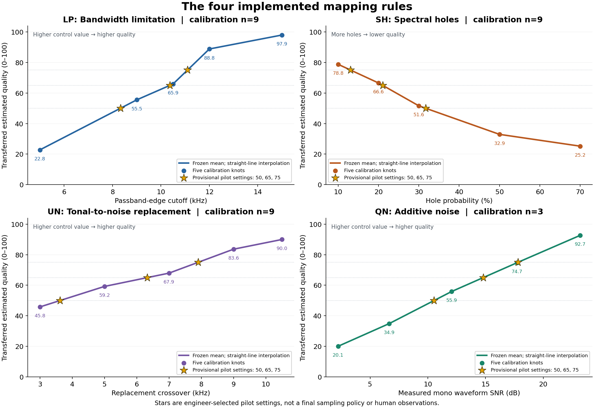
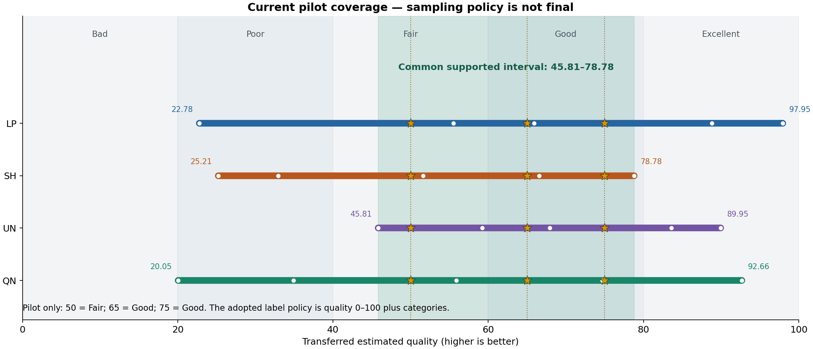
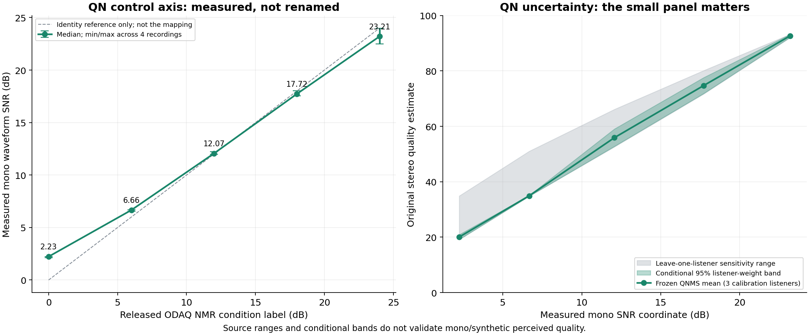

# Quality-label mapping: 0–100 and five categories

**Agreed label policy:** retain transferred estimated quality on the 0–100 scale and derive Bad/Poor/Fair/Good/Excellent. A separate 1–5 severity label is not adopted.

**Software snapshot:** package 0.3.0, profile mapped-poc-1. Stereo-to-mono and approximate-operator transfer assumptions remain explicit. The 50/65/75 pilot targets were an engineering choice, not a user-specified final sampling rule.

## The final decision

Use **one pooled calibration-mean curve per artifact**, with bounded piecewise linear interpolation and inverse lookup for generation. The controls are LP cutoff, SH probability, UN crossover and QN mono waveform SNR. All teammates use the same frozen table. The output label is **continuous transferred estimated quality plus its five-category label**. These are estimates, not newly measured human MUSHRA scores. The existing pilot targets 50/65/75 remain provisional software settings; the final dataset sampling policy is not specified by this label decision.

## 1. Rule for each generator

| Artifact | Mapped control | Direction of better estimated quality | Fixed processing choices |
|---|---|---|---|
| LP | Passband-edge cutoff, Hz | Higher cutoff | Causal Butterworth; 1500 Hz transition; 0.5 dB ripple; 60 dB attenuation |
| SH | Per-band/block hole probability, 0–1 | Lower probability | Start 4 kHz; 500 Hz bands; four-frame blocks; zero gain |
| UN | Replacement crossover, Hz | Higher crossover | Strength 1; 500 Hz envelope sigma; 12 dB peak threshold |
| QN | Mono waveform SNR, dB | Higher SNR | Local spectral-shaped additive noise; exact final SNR; original content retained |

LP/SH/UN use the original ODAQ pooled curves. SH does not combine the 2025 LR/MS/mixed contexts. QN uses the **separated QNMS** curve, not QNLR or a mixed-context curve. New recordings share the family curve; instrument/category does not select an ODAQ source-specific curve.

Circles are frozen calibration knots; straight lines are implemented interpolation; stars are provisional pilot requests, not an approved final sampling policy. Plot values retain the recorded transfer assumptions.

## 2. Mean versus median

At each parameter, average each calibration listener equally over the four reference recordings, average listeners within their cohort, then weight cohort means by original study size:

~~~text
Q(p) = Σ_c (N_c / N_total) × mean_i_in_cohort_c [mean_s_over_4_recordings rating(i,s,p)]
~~~

- LP/SH/UN: nine calibration listeners. Cohort weights 14/42, 12/42, 8/42 and 8/42; calibration counts 3/2/2/2.
- QNMS: three calibration listeners. Cohort weights 9/16 and 7/16; calibration counts 2/1.
- **Quality values are cohort-weighted means, not medians.**
- **Only QN's horizontal SNR coordinate is a median across four downmixed audio recordings.** Its vertical quality remains a mean rating.

Only the frozen approximately 20% calibration panel produced these means. The remaining 80% ratings did not select the generator settings. Averaged knots were already monotonic, so lookup and isotonic knots coincide. The active generator uses the pooled curve, not the earlier source-conditioned shrinkage models.

## 3. Interpolation and generation

Between adjacent knots:

~~~text
Forward: Q(p) = Q_i + (p−p_i)/(p_(i+1)−p_i) × (Q_(i+1)−Q_i)
Inverse: p(Q) = p_i + (Q−Q_i)/(Q_(i+1)−Q_i) × (p_(i+1)−p_i)
~~~

Generation normally uses the inverse. SH has decreasing quality with increasing probability; its quality-axis order is reversed for inversion. Full floating-point values are retained. Report rounding does not alter generation. No curve is extrapolated or refitted on a teammate's corpus.

**Worked example:** LP quality 65 falls between 9 kHz / 55.5119 and 10.5 kHz / 65.8968. Inversion produces a **10.370462 kHz passband edge**. This is not a −3 dB cutoff.

## 4. Existing pilot settings — not a final dataset sampling rule

The current pilot configuration generates three requests per artifact. This table documents the implementation; it does not establish the final sampling design:

| Artifact | Quality 50 parameter | Quality 65 parameter | Quality 75 parameter | Display unit |
|---|---:|---:|---:|---|
| LP | 8.326 | 10.370 | 11.096 | kHz |
| SH | 31.721 | 21.050 | 13.097 | % |
| UN | 3.625 | 6.327 | 7.903 | kHz |
| QN | 10.546 | 14.803 | 17.813 | dB SNR |

Internal units are Hz for LP/UN, probability 0–1 for SH and waveform dB SNR for QN. SH quality 65 therefore uses 0.210501, not 21.0501 as a raw probability. One excerpt yields 12 variants before no-op filtering.

### Support and category coverage

| Artifact | Supported estimated quality interval |
|---|---:|
| LP | 22.78–97.95 |
| SH | 25.21–78.78 |
| UN | 45.81–89.95 |
| QN | 20.05–92.66 |

The common interval is **45.81–78.78**, so the three provisional pilot requests fit every family without extrapolation. This overlap does not require retaining those requests in the final dataset.

Estimated categories are assigned after the point estimate: Bad [0,20), Poor [20,40), Fair [40,60), Good [60,80), Excellent [80,100]. **50 is Fair; 65 and 75 are both Good.** These are three numerical quality levels, not three categories or validated severity tiers. The existing pilot does not cover all five categories. Changing dataset sampling is a separate decision and must be applied consistently across workers. Do not invent labels or extrapolate curves just to populate a category.

## 5. QN's special rule

The released NMR condition label is not copied into our SNR setting. The x coordinates were measured from downmixed ODAQ QNMS reference/degraded pairs exported at 44.1 kHz mono:

~~~text
Released ODAQ label:             0       6       12       18       24
Measured median mono SNR:      2.229   6.661   12.065   17.724   23.206 dB
Transferred quality mean:     20.055  34.922   55.898   74.711   92.656
~~~

Waveform SNR is 10log10(sum(reference²)/sum(residual²)). Our generator adds locally spectral-shaped noise at the requested SNR while retaining the original content. The implemented transfer is **measured mono SNR → frozen QNMS stereo-quality prior**. This is an empirical coordinate change, not a psychoacoustic NMR model or universal NMR/SNR identity.

Left bars show min/max across four recordings, not confidence intervals. The right panel uses calibration-only results: conditional 95% listener-weight bands and actual leave-one-listener sensitivity. One of the three listeners retains 43.75% of panel weight. Those bands omit operator/mono transfer and unobserved population variation; a narrow band does not establish precise synthetic labels.

## 6. Runtime and metadata rules

- Record exact parameters, algorithm/profile IDs, seeds, actual masks/noise evidence, measured signal changes and source provenance.
- Write the prediction under calibration_estimate.estimated_quality_mean; derive estimated_quality_category separately. Preserve the table fingerprint and transfer assumptions.
- Keep human_mushra_score, audibility and human perceived_severity null. estimated_quality_loss_proxy = 100−quality is a quality-loss proxy, not percent distortion or human severity.
- Preserve conditional reference-listener bands separately; mono_transfer_validated and operator_transfer_validated remain false. Synthetic transfer intervals stay null.
- If processing selects nothing, the reference is silent, or relative residual energy is below the numerical tolerance 1e-20, write no_effect_quality_not_estimated and a null quality. Keep the audit record, omit it from training JSONL by default. This is not an audibility threshold.
- Reject unsupported generation requests. Queries outside support return null. QN 30/40 dB and SH quality 90 cannot be silently labeled.
- AudioLM rows contain exactly messages and audios, with reference before degraded. Residuals/evidence/rich metadata stay in aligned sidecars. Technical captions state processing facts; perceptual candidates remain unverified.

## 7. Shared-team rule

Every worker uses the same released code/profile, frozen mapping, numerical environment, master generation seed **20261111** and the same explicitly versioned sampling configuration. The present 50/65/75 configuration is a provisional pilot, not an agreed final dataset design. Per-example seeds are deterministic. Recording groups, portable path prefixes and fingerprint-checked merges preserve the common implementation.

The earlier listener split seed **20261110** and approximately 20/80 panel roles are distinct from the synthetic source split of 70/15/15. Neither listener selection nor mappings are rerun when processing another corpus. PE/TM remain excluded.

## 8. Implemented versus validated

The 0–100 score and category derivation are already implemented. The provisional pilot request set must not be mistaken for an agreed final sampling policy. Existing readiness evidence: **179 tests passed**; an installed wheel processed eight independent recordings in two workers, generating 96 triplets and exporting 92 examples after four no-op UN cases. Merged rows were train 60 / valid 12 / test 20. These establish engineering behavior and format compatibility, not human-perceptual validation.

The final Phase 1 decision is an **ODAQ-informed assumed-transfer POC**. Mono perceived quality, operator equivalence, new-content generalization and QN's small listener panel remain limitations. The report performs no new audio generation, fitting, held-out evaluation or model training.

## Appendix A. Frozen numerical knots

Values use each plot's displayed units. Full precision remains in mapping_table.json.

### LP: Passband-edge cutoff (kHz)

| Parameter | Estimated mean quality |
|---:|---:|
| 5.000 | 22.778 |
| 9.000 | 55.512 |
| 10.500 | 65.897 |
| 12.000 | 88.813 |
| 15.000 | 97.948 |
### SH: Hole probability (%)

| Parameter | Estimated mean quality |
|---:|---:|
| 10.000 | 78.782 |
| 20.000 | 66.571 |
| 30.000 | 51.607 |
| 50.000 | 32.933 |
| 70.000 | 25.206 |
### UN: Replacement crossover (kHz)

| Parameter | Estimated mean quality |
|---:|---:|
| 3.000 | 45.806 |
| 5.000 | 59.222 |
| 7.000 | 67.929 |
| 9.000 | 83.595 |
| 10.500 | 89.952 |
### QN: Measured mono waveform SNR (dB)

| Parameter | Estimated mean quality |
|---:|---:|
| 2.229 | 20.055 |
| 6.661 | 34.922 |
| 12.065 | 55.898 |
| 17.724 | 74.711 |
| 23.206 | 92.656 |

## Appendix B. Reproducibility and source of truth

- Frozen table: src/deepmushra_mapped/mapping_table.json.
- Forward/inverse code: src/deepmushra_mapped/mapping.py.
- Recipe: configs/generator.yaml and packaged profile.json.
- Generators: src/deepmushra_mapped/generators.py and shared DSP helpers.
- Numeric figure data: figures/final_mapping/default_parameters.csv.
- Profile fingerprint: 3af2e4150a832daf855ab151ce1cdbbef5927ca5b49be016fb1af6163471a798.
- Mapping table SHA256: a3c8a64d935b8ef9a70ee8e4783b2ca4468f0f400b2ddcbe129ee2bd5b2a7dd5.
- Frozen calibration model SHA256: 3ee63890861e144aeb237c48e760abfcf7a418d3cc8d79a83359e30f1d39e328.
- Listener split SHA256: 60c1f20d7335d595d282e2c7341fb8ed6be90302b26002b1eaf0bc5aac15f654.
- QN coordinate SHA256: eff2c6e6720fb047181548ae5c250669b20317031b12a055e281740d842a0350.

Regenerate from the checkout root:

~~~bash
python scripts/report_final_mapping.py
~~~

Outputs: this Markdown report, self-contained final_mapping_report.html, PNG/SVG figures and a verification receipt. The QN sensitivity panel uses docs/report_data/final_mapping_qn_sensitivity.json, a small aggregate snapshot of calibration-only fit/frozen_predictions.csv. Regeneration needs no ODAQ recordings or private calibration outputs. This report does not modify generators or mappings.

Related reports: team_generator_workflow.md; team_generator_readiness.md; odaq_calibration_phase1_poc.md; odaq_qn_downmix_poc.md.
