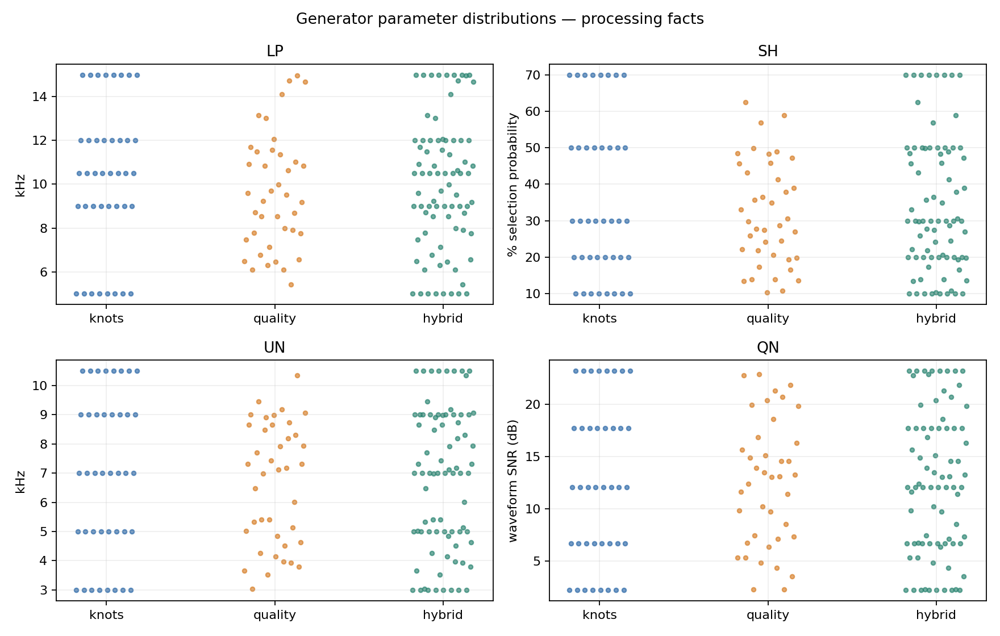
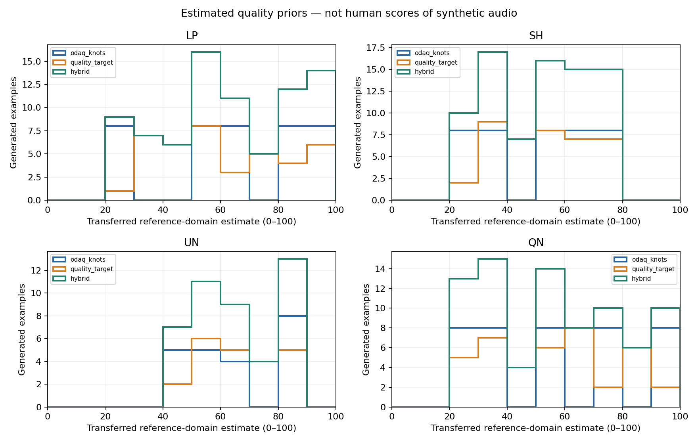
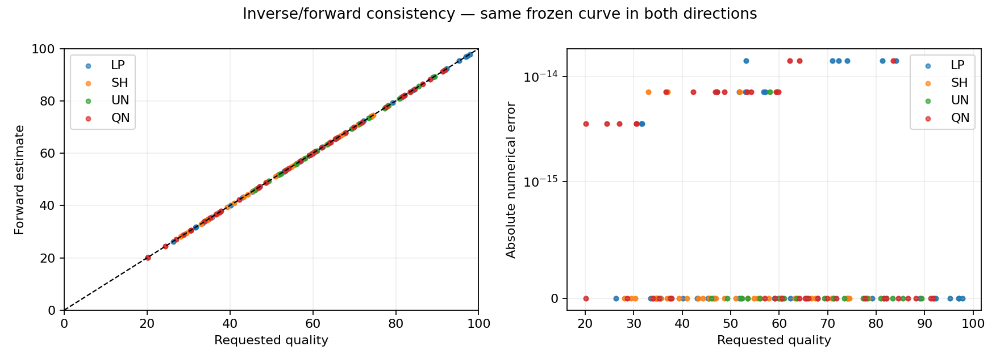
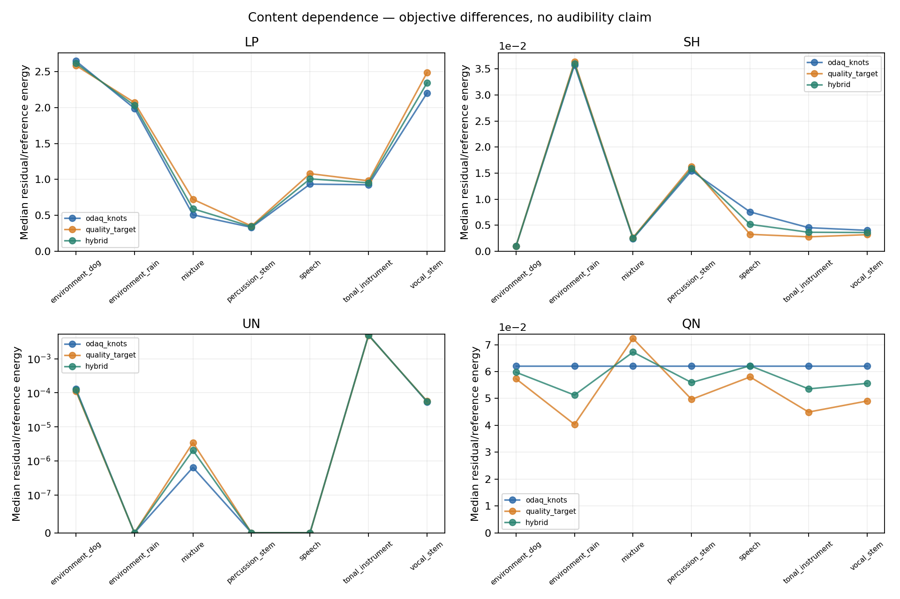
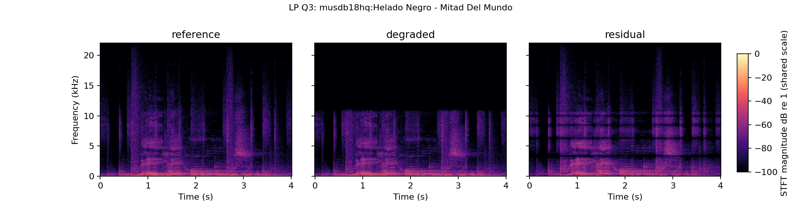
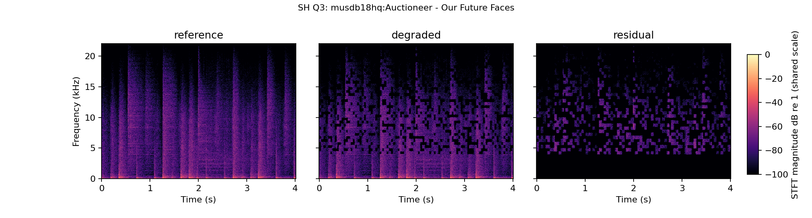
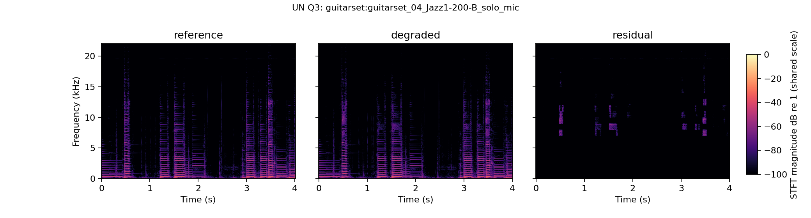
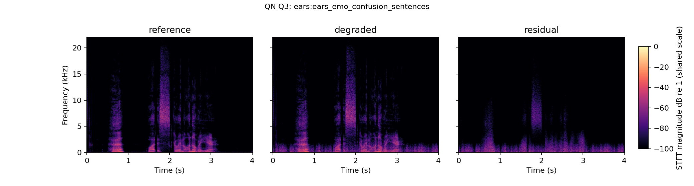

# Multi-mode sampling pilot: actual results

Release 0.4.0 uses sampling profile `mapped-poc-v2` and unchanged operator profile `mapped-poc-1`. Completed experiments use the unchanged four DSP operators and frozen ODAQ-informed mappings. Only independent source recordings enter synthetic generation. No calibration refit, held-out listener-score access, PE/TM generation, LLM description stage, full dataset generation or model training was performed.

## Observed counts

| Mode | Generated | Exported | No-op nulls | Skipped | Deduplicated | Train/valid/test |
|---|---|---|---|---|---|---|
| odaq_knots | 160 | 142 | 18 | 0 | 0 | 87/0/55 |
| quality_target | 160 | 142 | 18 | 0 | 0 | 87/0/55 |
| hybrid | 320 | 284 | 36 | 0 | 0 | 174/0/110 |

| Mode | Artifact | Attempted | Supported before dedup | Retained audio | Quality estimates | No-op nulls |
|---|---|---|---|---|---|---|
| odaq_knots | LP | 40 | 40 | 40 | 40 | 0 |
| odaq_knots | SH | 40 | 40 | 40 | 40 | 0 |
| odaq_knots | UN | 40 | 40 | 40 | 22 | 18 |
| odaq_knots | QN | 40 | 40 | 40 | 40 | 0 |
| quality_target | LP | 40 | 40 | 40 | 40 | 0 |
| quality_target | SH | 40 | 40 | 40 | 40 | 0 |
| quality_target | UN | 40 | 40 | 40 | 22 | 18 |
| quality_target | QN | 40 | 40 | 40 | 40 | 0 |
| hybrid | LP | 80 | 80 | 80 | 80 | 0 |
| hybrid | SH | 80 | 80 | 80 | 80 | 0 |
| hybrid | UN | 80 | 80 | 80 | 44 | 36 |
| hybrid | QN | 80 | 80 | 80 | 80 | 0 |

The three runs are alternative recipes: hybrid intentionally reuses the knot and continuous realizations from A/B on the same recording. Do not concatenate all three into one training set or count them as independent stimuli; cross-recipe fingerprints prevent normal team merging.

Sampling skips/deduplication and no-op export exclusions are separate. All five released conditions are supported for all four families, including QN through the empirical bridge. Continuous draws happened not to collide with knots within tolerance; dedicated exact-knot tests verify actual 10→5 deduplication while preserving both request origins.

## Category coverage

| Mode | Artifact | Bad | Poor | Fair | Good | Excellent | Null |
|---|---|---|---|---|---|---|---|
| odaq_knots | LP | 0 | 8 | 8 | 8 | 16 | 0 |
| odaq_knots | SH | 0 | 16 | 8 | 16 | 0 | 0 |
| odaq_knots | UN | 0 | 0 | 10 | 4 | 8 | 18 |
| odaq_knots | QN | 0 | 16 | 8 | 8 | 8 | 0 |
| quality_target | LP | 0 | 8 | 14 | 8 | 10 | 0 |
| quality_target | SH | 0 | 11 | 15 | 14 | 0 | 0 |
| quality_target | UN | 0 | 0 | 8 | 9 | 5 | 18 |
| quality_target | QN | 0 | 12 | 10 | 10 | 8 | 0 |
| hybrid | LP | 0 | 16 | 22 | 16 | 26 | 0 |
| hybrid | SH | 0 | 27 | 23 | 30 | 0 | 0 |
| hybrid | UN | 0 | 0 | 18 | 13 | 13 | 36 |
| hybrid | QN | 0 | 28 | 18 | 18 | 16 | 0 |

These are categories of transferred reference-domain mean estimates, not observed synthetic-domain human judgments. No supported mean is Bad; missing classes are not filled by extrapolation.

## Parameter and quality distributions

Maximum absolute target/forward difference: **1.4210854715202004e-14**, below 1e-8. This is a same-curve numerical consistency check, not human validation. Null/no-effect samples do not participate in that equality test.

The CSV also retains artifact-specific stopband attenuation (LP), eligible TF selection ratio (SH), selected-reference tonal contrast before/after (UN), and noise/reference PSD cosine plus saved SNR (QN). UN uses a nonnegative symlog axis to retain zero/no-op medians; the other energy axes are linear. Residual energy is a signal difference, not perceptual severity; causal LP phase can yield a large residual even when little high-frequency energy is removed.

## Actual saved-file verification

640 triplets inspected across all three pilots; every file is 44,100 Hz mono DOUBLE with matched sample count/grid and finite values. The saved residual equals saved degraded minus reference bit-exactly. Maximum reconstruction error is 2.7755575615628914e-17; maximum peak is 0.28733016, below .999. Prepared-reference lineage, audio/mask hashes, nominal condition units, inverse/forward fields, null human labels, both false transfer flags and all portable model paths were checked.

Current source-group split assignments are shared across the three distinct versioned dataset IDs because their explicit recording_group_id is stable. No recording crosses splits. The stable eight-group assignment produced zero validation rows in every mode; this is a generator/export pilot, not a training-ready train/validation experiment. Enlarge the independent source pool rather than changing recording identities to force a split. An eight-source pilot is not evidence of population/content coverage.

## Source recordings and restrictions

| Source | Content proxy | Native input Hz | Excerpt seconds | License |
|---|---|---|---|---|
| ears:ears_emo_confusion_sentences | speech | 48000 | 4.0 | CC BY-NC 4.0 |
| vctk:vctk_p250_100_mic1 | speech | 48000 | 1.242375 | CC BY 4.0 |
| guitarset:guitarset_04_Jazz1-200-B_solo_mic | tonal_instrument | 44100 | 4.0 | CC BY 4.0 |
| freesound:100032 | environment_dog | 44100 | 4.0 | CC BY-NC 3.0; clip attribution in ESC-50 LICENSE |
| freesound:17367 | environment_rain | 44100 | 4.0 | CC BY-NC 3.0; clip attribution in ESC-50 LICENSE |
| musdb18hq:Auctioneer - Our Future Faces | percussion_stem | 44100 | 4.0 | CC BY-NC-SA 4.0 |
| musdb18hq:Creepoid - OldTree | vocal_stem | 44100 | 4.0 | CC BY-NC-SA 4.0 |
| musdb18hq:Helado Negro - Mitad Del Mundo | mixture | 44100 | 4.0 | CC BY-NC-SA 4.0 |

Seven excerpts are four seconds; VCTK is 1.242375 seconds. Native rates are at least 44.1 kHz; no lower-rate source was upsampled. Header rate does not establish bandwidth or human-perceived cleanliness. Prior lossy ancestry is unknown for some references. These are real baseline recordings, not listening-certified transparent references. The two environmental clips were explicitly requested for this pilot, not a broader acquisition change. Existing source-ID exclusions were retained; no exhaustive identity screen is claimed. No new downloads occurred. Licenses and research-only/share-alike obligations must accompany any permitted redistribution; audio is ignored by Git.

## Unsupported explicit requests

| Artifact | Requested quality | Supported | Parameter | Decision |
|---|---|---|---|---|
| LP | 10.0 | False | None | quality_outside_calibration_support |
| LP | 30.0 | True | 5882.531215904959 | supported |
| LP | 50.0 | True | 8326.463813795612 | supported |
| LP | 70.0 | True | 10768.57142857143 | supported |
| LP | 90.0 | True | 12389.661164205041 | supported |
| SH | 10.0 | False | None | quality_outside_calibration_support |
| SH | 30.0 | True | 0.5759116589625063 | supported |
| SH | 50.0 | True | 0.31721206969825744 | supported |
| SH | 70.0 | True | 0.1719207019824505 | supported |
| SH | 90.0 | False | None | quality_outside_calibration_support |
| UN | 10.0 | False | None | quality_outside_calibration_support |
| UN | 30.0 | False | None | quality_outside_calibration_support |
| UN | 50.0 | True | 3625.2587991718433 | supported |
| UN | 70.0 | True | 7264.437689969606 | supported |
| UN | 90.0 | False | None | quality_outside_calibration_support |
| QN | 10.0 | False | None | quality_outside_calibration_support |
| QN | 30.0 | True | 5.193769539573369 | supported |
| QN | 50.0 | True | 10.545634561036751 | supported |
| QN | 70.0 | True | 16.307258387887945 | supported |
| QN | 90.0 | True | 22.39458293269346 | supported |

The support table itself did not generate audio or refit models. An additional one-source public-CLI explicit-target smoke check attempted 20 requests, generated 13, reported seven unsupported requests and exported 11 after two UN no-op exclusions. No target was clipped. Receipt: outputs/multi_mode_sampling_v2/explicit_smoke_verification.json. This diagnostic is separate from the three 640-triplet pilot totals. The explicit example config skips unsupported 10/30/50/70/90 requests and reports them. A run with no supported requests leaves a diagnostic bundle marked training_ready=false. No clipping to boundaries is performed.

## Actual metadata and spectrogram examples

Q3 examples use fixed content proxies: LP mixture, SH percussion, UN tonal instrument and QN speech, requiring a non-null transformation where available. This is illustration selection, not parameter tuning or human audibility selection.

### LP Q3

Complete JSON: [example](examples/sampling_v2/LP.json). Sample `538a79343977b3f6bdd8dc9a`, source `sampling-pilot-v2:musdb18hq:Helado Negro - Mitad Del Mundo`. Actual audio paths relative to `data/sampling-v2-odaq_knots/dataset/`:

- reference: `audio/reference/6d4dcbf52030a5e2c77babb1f4f8ba356d5734e24cc7eabf082eaa136645c0d0.wav`
- degraded: `audio/538a79343977b3f6bdd8dc9a/degraded.wav`
- residual: `audio/538a79343977b3f6bdd8dc9a/residual.wav`

Technical description: Low-pass filtering has a passband edge of 10.50 kHz. Candidate perceptual description (unverified): High-frequency detail may be reduced.

### SH Q3

Complete JSON: [example](examples/sampling_v2/SH.json). Sample `28bf0f2191c0b2b4ba7c978f`, source `sampling-pilot-v2:musdb18hq:Auctioneer - Our Future Faces`. Actual audio paths relative to `data/sampling-v2-odaq_knots/dataset/`:

- reference: `audio/reference/f3586cf2c35057515bf5ffd6e8a9fa9568c98116b1323d3406cc2ab2c13e5336.wav`
- degraded: `audio/28bf0f2191c0b2b4ba7c978f/degraded.wav`
- residual: `audio/28bf0f2191c0b2b4ba7c978f/residual.wav`

Technical description: Random spectral bands above 4 kHz are zeroed with per-band/block probability 30.0%. Candidate perceptual description (unverified): The sound may have intermittent spectral gaps.

### UN Q3

Complete JSON: [example](examples/sampling_v2/UN.json). Sample `fa439ccb7cb4f8673d1a3927`, source `sampling-pilot-v2:guitarset:guitarset_04_Jazz1-200-B_solo_mic`. Actual audio paths relative to `data/sampling-v2-odaq_knots/dataset/`:

- reference: `audio/reference/930e8ac52160475744f43a6d459b1269623147ccbbecbad8de8f0a97fe052b95.wav`
- degraded: `audio/fa439ccb7cb4f8673d1a3927/degraded.wav`
- residual: `audio/fa439ccb7cb4f8673d1a3927/residual.wav`

Technical description: Peak-selected bands above 7.00 kHz are replaced with envelope-shaped noise. Candidate perceptual description (unverified): Selected high-frequency content may sound less tonal.

### QN Q3

Complete JSON: [example](examples/sampling_v2/QN.json). Sample `fc1380892938eb1205937fc6`, source `sampling-pilot-v2:ears:ears_emo_confusion_sentences`. Actual audio paths relative to `data/sampling-v2-odaq_knots/dataset/`:

- reference: `audio/reference/b8d085fe6a3e2b0c83545acda363f886dada73df43a58d56553bda5a0bce1149.wav`
- degraded: `audio/fc1380892938eb1205937fc6/degraded.wav`
- residual: `audio/fc1380892938eb1205937fc6/residual.wav`

Technical description: Local spectral-shaped noise is added at a target waveform SNR of 12.07 dB. Candidate perceptual description (unverified): Added noise may make the sound rougher or noisier.

Complete [quality-target metadata](examples/sampling_v2/quality_target.json), [hybrid quality-component metadata](examples/sampling_v2/hybrid.json), and [actual training row](examples/sampling_v2/training_row.json) are also provided. Spectrogram panels use the same absolute magnitude scale, not independent normalization. They demonstrate signal modifications only.

## Tests, reproducibility and release evidence

218 passed in 93.53s (0:01:33). Tests cover real waveforms, all modes, bounded inverse, explicit skips, QN label/proxy distinction, UN strength, plateau tie handling, hybrid deduplication, deterministic output, sidecar serialization, source leakage, true benchmark rejection and harmless output-label acceptance. V1 baseline waveforms/parameters/seeds/calibration agree bit-exactly before/after. New release fingerprints/sample IDs intentionally differ because the code release changed.

Evidence remains on KNN in outputs/multi_mode_sampling_v2/: tests-release.log, legacy_release_compatibility.json, packaging_release_verification.json, the full per-example analysis CSVs and verification.json. A portable wheel loads v2 outside the checkout. The frozen mapping table, fitted models, bridge observations, listener split and DSP sources were not refit/modified. The actual-source subset repeat verifies 20/20/40 examples across A/B/C and 81/81/161 byte-identical audio, evidence and metadata files. See repeat-one-source/verification.json. Large initial vector-only heatmaps were archived under ignored outputs; report SVGs use compact rasterized heatmaps with vector axes.

## Mode recommendation and transfer limits

Use **odaq_knots** for generator validation and the first controlled five-condition Phase 1 POC. Use **hybrid** for a follow-up POC and future scaling after independent perceptual calibration: it retains interpretable knots and adds supported-range coverage. Use **quality_target** for quality-axis ablations/exploration; drawing five targets does not mean drawing five validated categories.

Exact processing strength, ODAQ stereo reference-domain estimate, unverified synthetic mono quality and actual human ratings are distinct. All actual synthetic human ratings remain null. LP edge/phase differences, SH mask semantics, UN detector/noise replacement and QN masking-versus-SNR mismatch remain unvalidated transfers. Three-listener QN conditional bands do not quantify population or mono/operator transfer uncertainty. Causal LP phase and centered STFT windows can introduce incidental temporal differences; the family holdout does not establish absence of every temporal cue. No-op prevalence and weak source bandwidth should be reviewed before scaling. Preserve the remaining listener panel for declared listener-held-out evaluation; this is ODAQ-informed, not a fully independent benchmark.

Implementation, exact configuration options and all three CLI reproduction commands: [sampling recipe](synthetic_sampling_recipe.md). Completed data are data/sampling-v2-odaq_knots/, data/sampling-v2-quality_target/ and data/sampling-v2-hybrid/. Never overwrite prior output directories.
